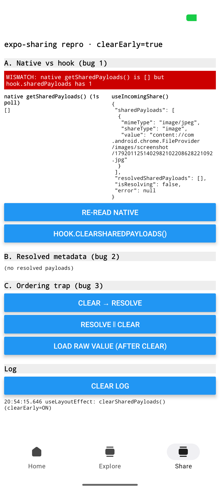
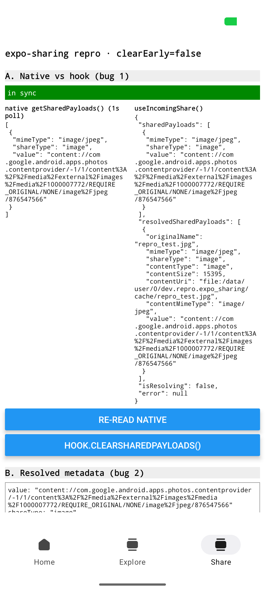
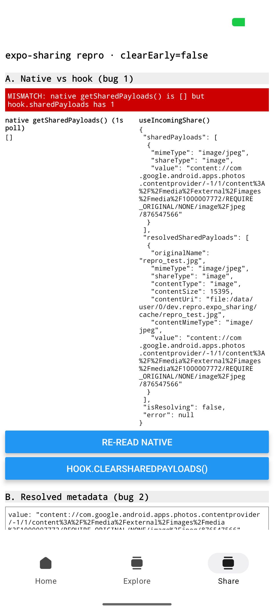
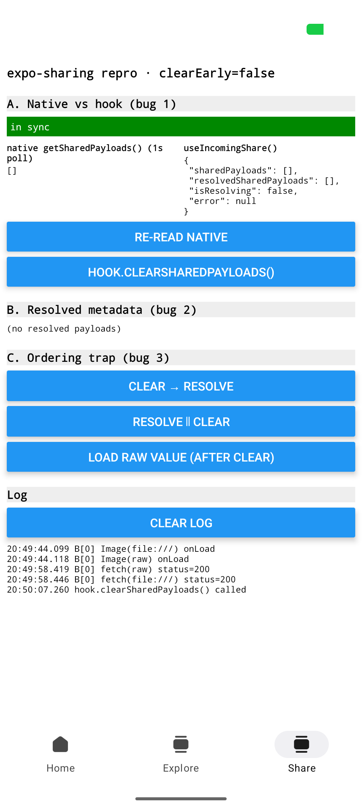
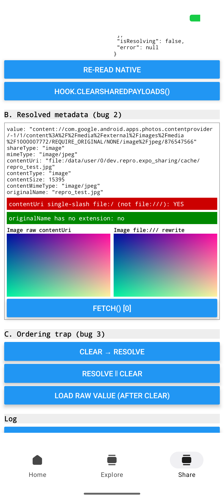
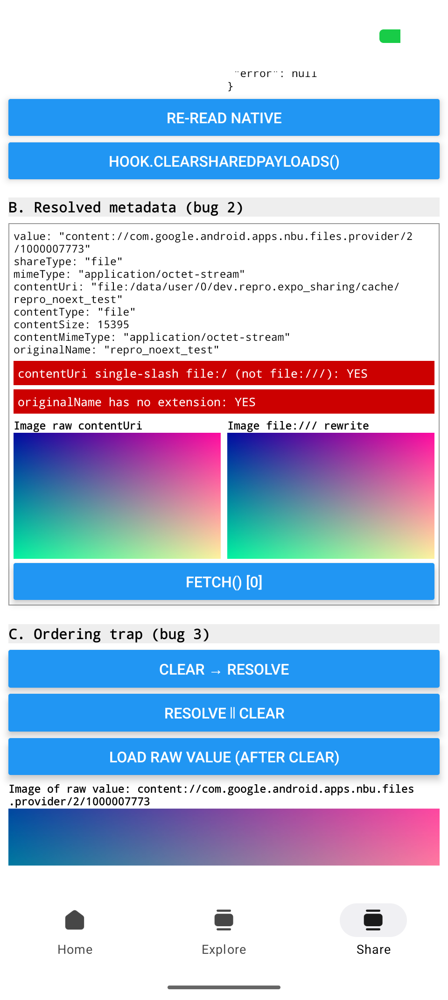

# expo-sharing share-into reproducer (SDK 58 beta)

A minimal app that reproduces three `expo-sharing` share-into issues on Android. It is the
`default@sdk-58` template plus:

- `src/app/+native-intent.ts`: the redirect from the docs (`expo-sharing` host → `/handle-share`)
- `src/app/handle-share.tsx`: the diagnostic screen (also reachable from the **Share** tab)
- `src/repro/flags.ts` + a `clearEarly` switch on the Home tab (bug 1 trigger)
- the `expo-sharing` config plugin in `app.json`

## At a glance

All screenshots come from a Pixel 9 Pro (Android API 37) running a release build. The shared
image is a synthetic gradient. Click a thumbnail for the full-size image.

### Bug 1: `useIncomingShare` reports a share that native has already cleared

The strong form: `clearSharedPayloads()` runs in a `useLayoutEffect` before the hook's mount effect.

| 1. Share from Chrome with `clearEarly` on | 2. Background → foreground |
| :-: | :-: |
| <a href="repro/bug1-strong-clearEarly-chrome.png"></a> | <a href="repro/bug1-strong-after-bg-fg.png"></a> |
| **MISMATCH**: native is `[]`, but the hook still has the Chrome payload. `resolvedSharedPayloads` stays `[]`, with `isResolving: false` and `error: null`. | **Still MISMATCH.** The hook never recovers, and the share never resolves. |

The weak form: the hook's own `clearSharedPayloads()`.

| 1. Shared from Photos, before clearing | 2. After `hook.clearSharedPayloads()` | 3. Background → foreground |
| :-: | :-: | :-: |
| <a href="repro/photos-warm-A.png"></a> | <a href="repro/bug1-weak-after-hook-clear.png"></a> | <a href="repro/bug1-weak-after-bg-fg.png"></a> |
| In sync. | **MISMATCH**: native is cleared, but hook state is unchanged. | In sync again, but only because AppState fired `active`. |

### Bug 2: `contentUri` is `file:/…` (single slash) and `originalName` is passed through as-is

| Google Photos (warm) | Files by Google (warm, extensionless file) | Google Photos (cold start) |
| :-: | :-: | :-: |
| <a href="repro/photos-warm-B.png"></a> | <a href="repro/files-warm-B-C.png"></a> | <a href="repro/photos-cold-A.png"></a> |
| `file:/data/user/0/…/repro_test.jpg`. **Both** the raw and `file:///` `<Image>` load, and `fetch()` returns 200 for both. | Single slash, and `originalName: "repro_noext_test"` with no extension. Both images load. | The same single-slash `contentUri` after a cold start. |

The single slash is non-canonical, but on this device it did **not** break expo-image or `fetch`.

### Bug 3: clearing before or during resolve returns `[]` with no error

| Action (a payload was present beforehand) | Result |
| --- | --- |
| `clearSharedPayloads()`, then `await getResolvedSharedPayloadsAsync()` | resolves `[]` |
| `getResolvedSharedPayloadsAsync()` started, then `clearSharedPayloads()` called immediately | resolves `[]` |
| `<Image>` of the raw `content://` value after the clear | loads (bottom of the Files screenshot above) |
| `fetch()` of the raw `content://` value after the clear | `fetch failed: Call to function 'NativeRequest.start' has been rejected.` (probably unrelated, see below) |

The exact log lines for every run are in [`repro/log.txt`](repro/log.txt).

## Versions

| package          | version      |
| ---------------- | ------------ |
| expo             | 58.0.9       |
| expo-sharing     | 58.0.17      |
| expo-router      | 58.0.18      |
| expo-image       | 58.0.14      |
| react-native     | 0.88.0-rc.4  |
| react            | 19.3.0       |

Tested on a Pixel 9 Pro running Android API 37, with a **release** build.

> `.npmrc` sets `legacy-peer-deps=true`. Without it, `npm install` on the SDK 58 template fails:
> `react-native-reanimated@4.7.0` declares the peer range `0.86 - 0.88`, which does not match the
> prerelease `0.88.0-rc.4`.

## Build and run

Config plugins don't work in Expo Go, so this needs a native build.

```sh
npm install
npx expo prebuild --clean --platform android
npx expo run:android --variant release   # use release for cold-start checks
```

Don't use the dev client for cold-start checks: its launcher receives the share intent first and
drops the URI read grant.

## The `/handle-share` screen

- **A. Native vs hook**: shows `getSharedPayloads()` (polled every 1s) next to the full
  `useIncomingShare()` result. A red **MISMATCH** banner appears when native is `[]` but the hook
  still has payloads.
- **B. Resolved metadata**: shows every field of each resolved payload and flags a
  single-slash `file:/` URI or an extensionless `originalName`. It renders `<Image>` (expo-image)
  with the raw `contentUri` and with a `file:///` rewrite, and has a `fetch()` button for both.
- **C. Ordering trap**: three buttons: `clear → resolve`, `resolve ∥ clear`, and `load raw value`
  after a clear.
- A timestamped log. Each line is also written to logcat (`adb logcat -s ReactNativeJS | grep '\[repro\]'`).

The screen renders only while it is focused. Tabs keep screens mounted, so without this a warm
share would reuse the existing hook instance instead of mounting a new one, the way a pushed share
screen would.

## Bug 1: `useIncomingShare` gets out of sync with native

`useIncomingShare` (`src/useIncomingShare.ts:39,43,50`) seeds its state with
`useState(getSharedPayloads())`, but sets `currentSharedDataRef` to `[]`. Its own
`clearSharedPayloads` (`:94`) clears native state only. Hook state updates on the next AppState
`active` event (`:78-82`).

**Strong form (deterministic):**

1. On the Home tab, turn on **clearEarly**.
2. In Chrome, long-press an image → **Share image** → **expo-sharing-reproducer**.
3. `handle-share` calls `clearSharedPayloads()` in a `useLayoutEffect`, which runs before the
   hook's passive mount effect.

- **Expected:** the hook reports what native reports (`[]`), or at minimum resolves the payload it
  shows.
- **Actual:** a **MISMATCH** that never goes away. `sharedPayloads` holds the Chrome payload,
  `resolvedSharedPayloads` is `[]`, `isResolving` is `false` and `error` is `null`, so the share
  never resolves. The state is unchanged after background → foreground.
  See `repro/bug1-strong-clearEarly-chrome.png` and `repro/bug1-strong-after-bg-fg.png`.

**Weak form:**

1. Turn off clearEarly and share anything.
2. Press **hook.clearSharedPayloads()**.

- **Expected:** hook state empties.
- **Actual:** native is `[]` but the hook still shows the payload (MISMATCH) until the next
  background → foreground, which clears it. See `repro/bug1-weak-after-hook-clear.png` and
  `repro/bug1-weak-after-bg-fg.png`.

## Bug 2: resolved metadata on Android

`ResolvingShareIntentDataParser.resolveUri` builds `contentUri` with `File.toURI().toString()`,
which produces `file:/data/...` with a single slash. `originalName` is the provider's
`DISPLAY_NAME`, used as-is.

- **Actual:** every source (Google Photos, Files, Chrome; warm and cold) returned
  `contentUri: "file:/data/user/0/dev.repro.expo_sharing/cache/<name>"`.
- **But on this setup the single slash did not break anything.** expo-image `<Image>` loaded the
  raw URI, and `fetch()` returned 200 for both the raw and the `file:///` forms. The bug is that
  the URI is non-canonical and differs from the `file:///` form other Expo APIs return; I saw no
  load failure. See `repro/photos-warm-B.png` and `repro/files-warm-B-C.png`.
- `originalName` without an extension was reproduced only with a file that has no extension on
  disk (`repro_noext_test`, shared from Files). Google Photos returned `repro_test.jpg`, not a
  numeric `DISPLAY_NAME`. Chrome returned a numeric name, but it kept `.jpg`.
- The cache file is named after `originalName`. Two shares with the same display name overwrite
  each other's cache file. (Seen in the code, not exercised here.)

## Bug 3: clearing before or during resolve returns `[]` silently

`getResolvedSharedPayloadsAsync` (`SharingModule.kt:69-78`) reads `SharingSingleton.intent` when
the async body runs. `clearSharedPayloads` sets it to `null` synchronously.

| action (payload present beforehand)                           | result                          |
| ------------------------------------------------------------- | ------------------------------- |
| `clearSharedPayloads()` then `await getResolvedSharedPayloadsAsync()` | resolves `[]` (no rejection) |
| start `getResolvedSharedPayloadsAsync()`, then `clearSharedPayloads()` without awaiting in between | resolves `[]` (no rejection) |

So there is no rejection message to report: both calls succeed and return `[]`. The trap is that
a consumer who clears "right after" starting the resolve gets nothing, with no error.

After a clear, the raw `value` (`content://com.google.android.apps.nbu.files.provider/...`):
- `<Image>` still loads (`Image(raw) onLoad`), so the read grant was still held while the
  activity was alive.
- `fetch()` rejects with `Error: fetch failed: Call to function 'NativeRequest.start' has been rejected.`
  This is probably because `fetch` does not support `content://` at all, not because of the
  clear. I didn't test `fetch(content://)` before a clear, so this is inconclusive.

## Evidence

`repro/` contains the screenshots named above, plus `repro/log.txt` with the on-screen and logcat
log text for every run. The shared image is a synthetic gradient
(`repro_test.jpg` / `repro_noext_test`).

## iOS

Not tested. Only bug 1 applies there, and it lives in the shared JS hook.
