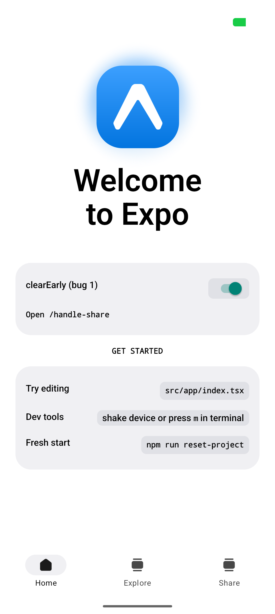
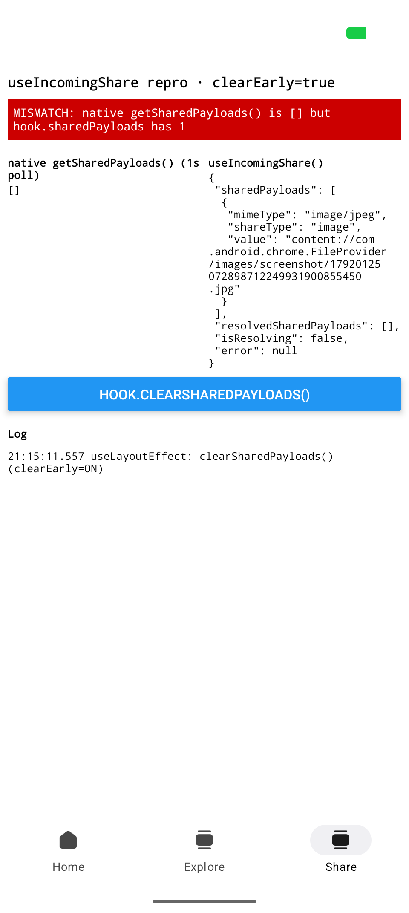
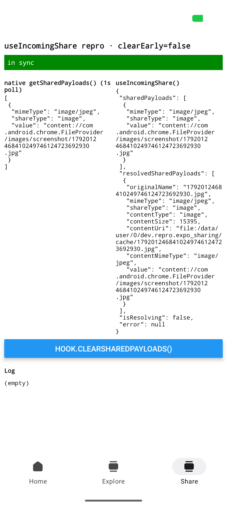
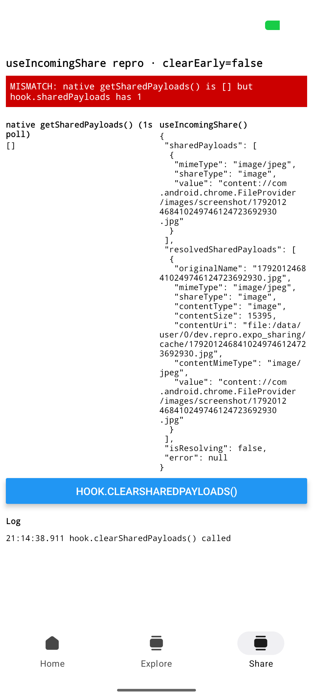
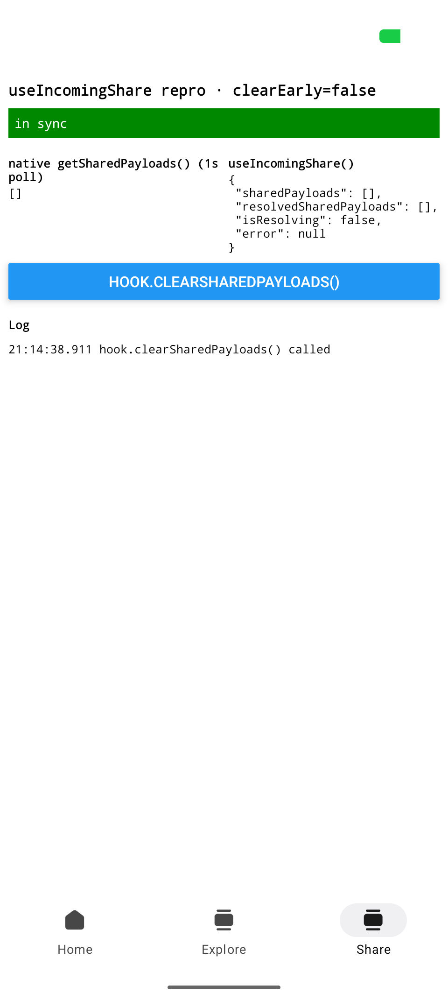

# expo-sharing reproducer: `useIncomingShare` does not update after a clear

## Summary

When the app clears the shared payload, `useIncomingShare()` does not update. The hook continues to
show the payload that native no longer has.

- **Strong form:** the hook never updates. The hook also never resolves the payload.
- **Weak form:** the hook updates only after the app goes to the background and comes back.

This app is a minimal Expo SDK 58 (beta) app that shows both forms on Android.

## At a glance

All screenshots come from a Pixel 9 Pro (Android API 37) with a release build. Each test shares
an image from Chrome. Click a thumbnail to open the full-size image.

### Strong form: the app clears the payload before the hook runs its first refresh

The share screen calls `clearSharedPayloads()` in a `useLayoutEffect`. React runs a layout effect
before the hook's own effect, so the clear happens first.

| 0. Turn on `clearEarly` | 1. Share an image from Chrome | 2. Background → foreground |
| :-: | :-: | :-: |
| <a href="repro/strong-0-clearEarly-on.png"></a> | <a href="repro/strong-1-shared.png"></a> | <a href="repro/strong-2-after-bg-fg.png"></a> |
| The toggle is on the Home tab. | **MISMATCH.** Native is `[]`. The hook still has the payload. `resolvedSharedPayloads` is `[]`. | **MISMATCH.** The hook did not update. |

### Weak form: the app clears the payload with the hook's own function

| 1. Share an image from Chrome | 2. Tap `hook.clearSharedPayloads()` | 3. Background → foreground |
| :-: | :-: | :-: |
| <a href="repro/weak-1-shared.png"></a> | <a href="repro/weak-2-after-hook-clear.png"></a> | <a href="repro/weak-3-after-bg-fg.png"></a> |
| In sync. | **MISMATCH.** Native is `[]`. The hook still has the payload. | In sync. The hook updated when the app became active. |

The logcat output for both tests is in [`repro/log.txt`](repro/log.txt).

## Expected behavior

When native has no payload, the hook state is empty. This applies after any clear, including the
clear from the hook's own `clearSharedPayloads()`.

## Cause

The hook keeps two copies of the payload:

1. **State.** On mount, the hook reads the native payload into state.
2. **A last-known value.** The hook uses this value to detect a change. This value starts as `[]`.
   It does not start as the payload.

On each refresh, the hook compares the native payload with the last-known value. If the two are
equal, the hook stops and does not update state.

This causes the two forms:

- **Strong form.** The app clears native before the first refresh. Native is `[]`, and the
  last-known value is `[]`. The two are equal, so the hook stops. State keeps the payload. Each
  later refresh also compares `[]` with `[]`, so state never changes.
- **Weak form.** The hook's `clearSharedPayloads()` clears native only. It does not clear state.
  State changes at the next refresh. The hook refreshes only when the app becomes active.

### Source

These references are to `src/useIncomingShare.ts` in `expo-sharing@58.0.17`. The same code is in
57.0.5 and on `main`.

- Line 39: state starts as `getSharedPayloads()`.
- Line 43: the last-known value (`currentSharedDataRef`) starts as `[]`.
- Line 50: the refresh stops when the two values are equal.
- Lines 78–82: a refresh occurs when AppState changes to `active`.
- Line 94: the hook returns the native `clearSharedPayloads`.

## Steps

### Build and install

This app requires a native build. Config plugins do not work in Expo Go.

```sh
npm install
npx expo prebuild --clean --platform android
npx expo run:android --variant release
```

### Strong form

1. Open the app.
2. On the Home tab, turn on **clearEarly (bug 1)**.
3. In Chrome, touch and hold an image.
4. Tap **Share image**.
5. Select **expo-sharing-reproducer**.
6. Read the banner. The banner shows **MISMATCH**.
7. Put the app in the background.
8. Open the app again.
9. Read the banner. The banner still shows **MISMATCH**.

### Weak form

1. Open the app.
2. On the Home tab, make sure that **clearEarly** is off.
3. Share an image from Chrome. Use steps 3 to 5 of the strong form.
4. Tap **hook.clearSharedPayloads()**. The banner shows **MISMATCH**.
5. Put the app in the background.
6. Open the app again. The banner shows **in sync**.

The `clearEarly` toggle is in module scope. If the app process stops, the toggle resets to off. To
test a cold start, change the default value in `src/repro/flags.ts`. Then build the app again.

## Contents of the app

This app is the `default@sdk-58` template with these additions:

- `app.json`: the `expo-sharing` config plugin for images, files, and text.
- `src/app/+native-intent.ts`: the redirect from the documentation. The redirect sends the
  `expo-sharing` host to `/handle-share`.
- `src/app/handle-share.tsx`: the share screen. The screen shows the native `getSharedPayloads()`
  value and the `useIncomingShare()` result side by side. The screen reads native every second.
  A red **MISMATCH** banner shows when the two do not agree. The screen also writes its state to
  logcat as `[repro]` lines.
- `src/repro/flags.ts`: the `clearEarly` toggle. The switch for the toggle is on the Home tab.

The share screen is the third tab, **Share**. A tab stays mounted when it is not visible. For this
reason, the share screen renders only when it is focused. Each share then mounts a new
`useIncomingShare()`, as a pushed share screen does.

## Versions

| package      | version     |
| ------------ | ----------- |
| expo         | 58.0.9      |
| expo-sharing | 58.0.17     |
| expo-router  | 58.0.18     |
| react-native | 0.88.0-rc.4 |
| react        | 19.3.0      |

`.npmrc` sets `legacy-peer-deps=true`. Without this setting, `npm install` fails on the SDK 58
template. The reason is that `react-native-reanimated@4.7.0` requires `react-native` `0.86 - 0.88`,
and that range does not include the prerelease `0.88.0-rc.4`.

## Notes

- Use the release build to test a cold start. In a development build, the dev client receives the
  share intent first and removes the permission to read the shared URI.
- The bug is in the shared JavaScript hook. The bug should also occur on iOS. This app was tested
  on Android only.
